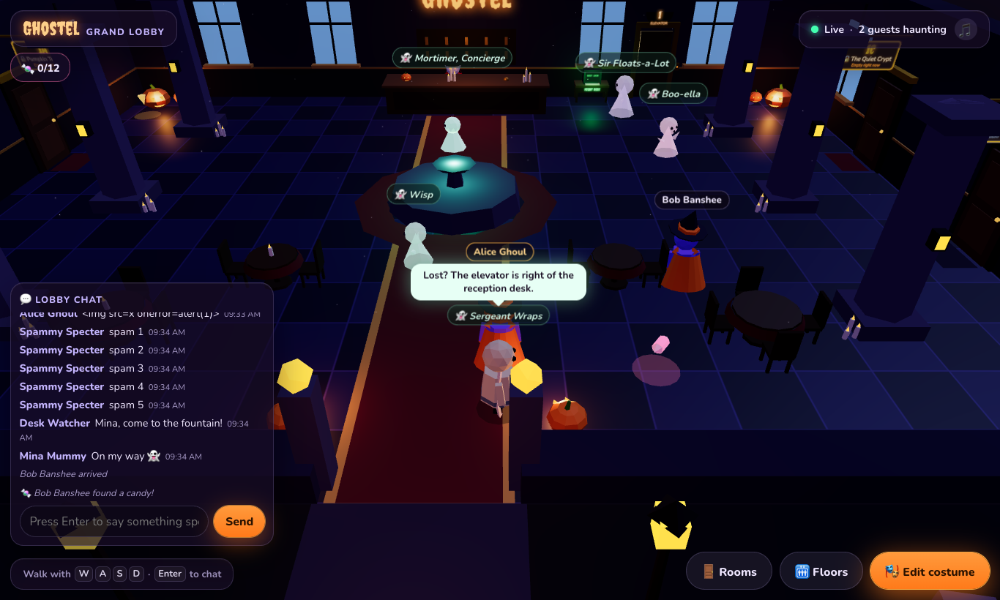
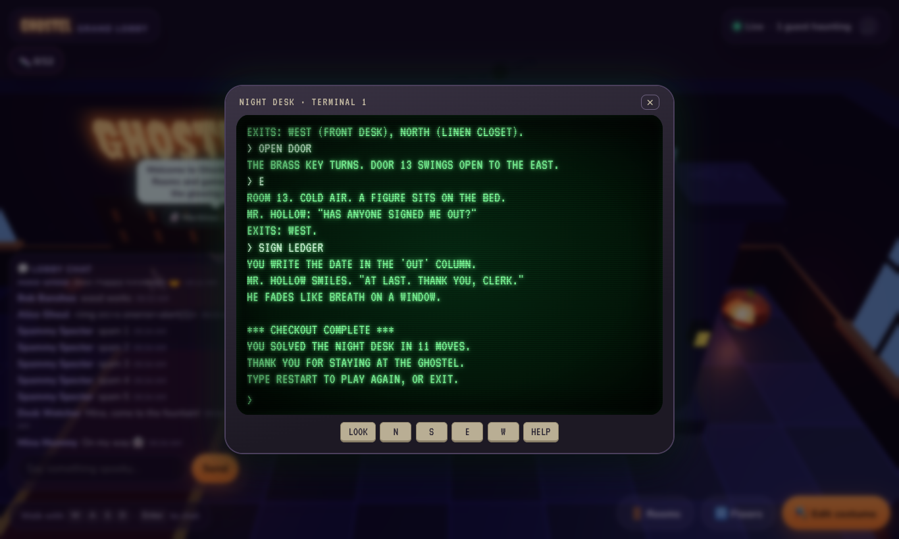

# Ghostel

**Check in. Hang out. Play till dawn.**

Ghostel is a low-poly 3D haunted hotel in the browser. Guests build a costumed character, walk the candle-lit Grand Lobby and see every other guest move in realtime. No account needed. Built with [Kiro](https://kiro.dev) for Kiroween 2026.



## What works now (milestones 1–14, 16 and 17)
- Character creator: heads (classic, pumpkin, skull, black cat, vampire, werewolf, Frankenstein, zombie, alien), hats (witch, top hat, horns, pirate, bat ears, and a Golden Crown to unlock), costumes (vampire cape, ghost sheet, mummy wraps, bat wings, skeleton, wizard robe, zombie rags, werewolf fur), body and accent colours, "Surprise me", live 3D preview.
- Guest sessions without login: HttpOnly cookie, profile saved in PostgreSQL, survives reloads. Change your name or costume any time.
- Grand Lobby: fountain with a floating ghost, reception desk, pillars with lanterns, jack-o'-lanterns, candles, bats and moonlight.
- Realtime presence over WebSocket. The server validates every move (bounds, obstacles, speed) and is the only source of positions other guests see.
- Desktop (WASD / arrow keys) and phone (virtual joystick) controls.
- Rooms behind numbered doors: 1A–1D in the lobby, 2A–2F in the Hall of Portraits and 3A–3D in the Greenhouse, so friends can say "meet me at 2B". Each door's plaque shows its code, the room name (or "Vacant") and how many guests are inside, live; occupied doors stand ajar with light spilling out. Walk up and press E (or tap): a vacant door opens the create form for that door, a password door asks for the password, an open door lets you straight in. Leaving a room puts you back in front of its door. Rooms have a theme (crypt, haunted library, ballroom) and an access mode (open, locked, password). Each room is its own 3D scene and realtime channel, so outsiders never receive its chat or movement. Passwords are checked on the server against argon2id hashes and guessing is throttled. Guest rooms nobody used for 3 days are released so doors never run out.
- Five floors connected by an elevator: the Grand Lobby, the Hall of Portraits (paintings whose eyes follow you, a costume runway and the Mirror of Costumes), the Moonlit Greenhouse (giant pumpkins that glow as you pass, a bubbling cauldron, fireflies), Ghoul's Diner (a canteen with a skeleton cook, a vampire waiter, a jukebox and lots of tables; order a snack at the counter and hold it for a minute so everyone sees it) and the Rooftop Graveyard (a huge moon, tombstones with honest epitaphs, and a lit night city far below with traffic, a river, a clock tower and a radio mast). Each floor is its own realtime channel with its own chat.
- Tables for 2 and 4 on every floor: walk up to a chair and press E (or tap, or gamepad A) to sit. Everyone at the same table is in one call and the screen turns into a Zoom-like meeting: a tile per person with their costume badge or camera, a speaking glow, mic and camera buttons, and "Stand up". Only the guests at that table are connected.
- Rooms hold 2–8 guests (chosen when the room is created) and have a long table with that many chairs. Everyone inside a room shares one call; sitting at the long table opens the meeting view.
- Camera and microphone are off until you click them (peer-to-peer WebRTC, small video tiles).
- Presentations in rooms: the owner presents directly, other guests ask and the owner allows or refuses. Share your screen (desktop browsers) or show PDF slides (up to 10 MB, kept in server memory only, rendered with pdf.js); the presenter turns the pages for everyone. The presentation shows on the meeting stage, in a floating panel and on a big screen in the 3D room.
- Phones in portrait and landscape: an on-screen gamepad with a floating analog stick on the left and an action button on the right; panels and chat fit short landscape screens; a full-screen button on Android. Physical gamepads work too (left stick or d-pad, A to act, B to go back).
- Candy hunt: 12 candies hidden across the floors, checked by the server (right floor, close enough) and saved to your profile. Find them all to unlock the Golden Crown.
- Original music for every floor (a music-box waltz, a harpsichord minuet, a celesta lullaby and a theremin nocturne), performed live in the browser and cross-faded when you change floors.
- The hotel is never empty: ghosts and monsters drift around every floor and give tips when you walk up to them (Wisp, Boo-ella, Sir Floats-a-Lot and Sergeant Wraps the mummy in the lobby, Mortimer the vampire concierge who greets you by name, the Frankenstein Curator and Lady Whisper upstairs, Gourdon the werewolf gardener and Moldy Mo the zombie in the greenhouse, Stargazer Stella and Zorp the alien tourist on the roof), and every room has a host ghost. Three house rooms (Pumpkin Trivia Hall 1A, Midnight Library 1B with Monster Pairs, The Quiet Crypt 1C) are always open.
- Pumpkin Trivia at the room table: 7 Halloween questions, 15 seconds each, with points for speed, a live scoreboard, a reveal showing who picked what, and a podium. Plays against Jack O'Bot when you are alone. Keys 1–4 on desktop, a 2×2 grid on phones, and small synthesized sound effects. The server owns the questions, timer and scores, and never sends the answer before the reveal.
- Monster Pairs (house room 1B, or any room with that activity): a turn-based memory game with the creator's monster heads. Flip two cards; a match keeps your turn. Jack O'Bot plays when you are alone and forgets some cards. The server owns the board and never sends the face of a card that is down.
- The Ghostel Game Kit: both games run on one `GameEngine` interface, and the server hub has no game-specific code. See [docs/GAME-KIT.md](docs/GAME-KIT.md).
- Calls in rooms and at tables: unmute to talk, a live "n in call · n connected" pill, and name tags that glow while someone speaks.
- Lobby chat with speech bubbles above characters, recent history for late arrivals, and a phone chat sheet with an unread badge. The server normalises text, strips control and bidi-override characters and rate-limits each guest across all their tabs.
- The Haunted Mirror (floor 2): at the Mirror of Costumes, click "Look into the mirror" and your own camera appears in the glass as a ghost: mirrored, violet-tinted, rippling, with a faint second figure behind you. The camera stays on your device and turns off when you click again or walk away.
- The Night Desk (lobby): a 1987 green-screen terminal on a desk next to the reception. Press E to log in and play a short original text adventure ("one guest never checked out of room 13"). `WHO` and `ROOMS` list the guests and doors in the lobby. Quick buttons make it playable on phones.



Coming next: the public HTTPS deployment (see [docs/DEPLOY.md](docs/DEPLOY.md)), then submission material. See [docs/PROGRESS.md](docs/PROGRESS.md).

## Stack
pnpm monorepo, TypeScript strict everywhere.

| Path | What |
| --- | --- |
| `packages/shared` | Domain rules: name/look validation (zod), lobby layout, movement authority, wire protocol |
| `apps/server` | Node 24, Fastify, `ws`, PostgreSQL (`pg`) |
| `apps/web` | React 19, Vite, React Three Fiber, drei |

## Run locally
Needs Node 24+, pnpm 11 and Docker.

```sh
cp .env.example .env
pnpm install
pnpm db:up        # PostgreSQL 18 on 127.0.0.1:5490
pnpm dev          # server :2590 + web :5290
```
Open http://localhost:5290. Open a second browser profile or a private window to see a second guest.

## Checks
```sh
pnpm typecheck
pnpm test         # 136 shared + 8 web unit + 90 server integration tests (needs pnpm db:up)
pnpm test:e2e     # builds, resets ghostel_test, then 29 Playwright tests (fake microphone, camera and screen; short games)
pnpm test:prod    # production build with NODE_ENV=production: secure cookie, headers, CSP
pnpm build
```
Latest real output is in [docs/evidence/](docs/evidence/).

## Security notes
- The session cookie holds a random 32-byte token; only its SHA-256 hash is stored. No endpoint accepts a guest ID.
- Writes and WebSocket upgrades require an allowed `Origin`. Payload sizes and message rates are capped.
- Positions from clients are clamped to the building, pushed out of obstacles and speed-limited on the server.
- Room passwords are hashed with argon2id (`@node-rs/argon2`), never returned by any API or WebSocket message, and limited to 5 guesses per minute per guest and room. Only the owner (by session) can change or delete a room.

## Deploy
`render.yaml` describes one Render web service (web + API + WebSocket on one origin) using a Neon database. Follow [docs/DEPLOY.md](docs/DEPLOY.md).

## Calls, camera and privacy
- Calls are peer-to-peer WebRTC. Like every P2P call, they show your IP address to the other people in the call. Ghostel only signals between members of the same call: the guests inside one room, or the guests seated at one table.
- Microphone, camera and screen share start only after you click them, and stop when you leave the call (stand up, leave the room, change floor or close the tab).
- The Haunted Mirror uses a separate camera stream that is never sent anywhere: no call, no server. It stops when you click again, walk away, sit down or change floor.
- Every person sends their media to every other person in the call (a mesh), so calls stay small: tables seat 2 or 4, rooms hold up to 8 guests, and camera tiles are about 320×240. Bigger video calls would need an SFU such as LiveKit Cloud.
- PDF slides are kept in the server's memory only, only guests inside that room can download them, and they are deleted when the presentation ends.
- Some networks block direct connections. Set `VOICE_ICE_SERVERS` to add a TURN server. LiveKit Cloud is the planned fallback for larger calls.

## Built with Kiro
Specs live in `.kiro/specs/`, steering rules in `.kiro/steering/`, hooks in `.kiro/hooks/`. The session log is in [docs/KIRO-ACTIVITY.md](docs/KIRO-ACTIVITY.md).

## License
[MIT](LICENSE). Asset sources and licenses: [docs/ASSETS.md](docs/ASSETS.md).
